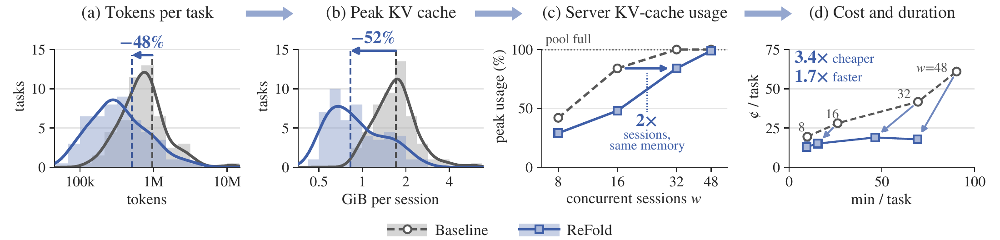
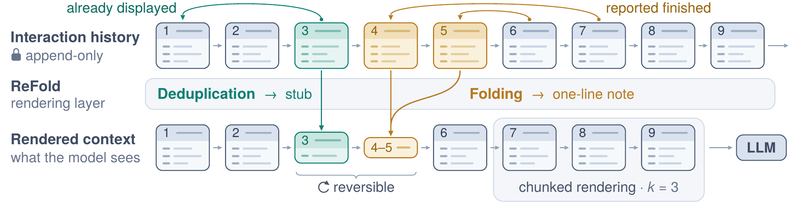

<div align="center">

# ReFold

### Training-Free Reversible Inter-Turn Context Folding for Long-Horizon Agents

[Yupeng Su](https://yupengsu.github.io/)<sup>1</sup>, Jiayi Tian<sup>1</sup>, Zheng Zhang<sup>1</sup>, Souvik Kundu<sup>2</sup>

<sup>1</sup>University of California, Santa Barbara &nbsp;&nbsp; <sup>2</sup>Intel

[](https://arxiv.org/pdf/2610.07863)
[](https://arxiv.org/abs/2610.07863)
[](https://yupengsu.github.io/ReFold/)
[](LICENSE)



<sub>With Qwen3.6-27B on SWE-bench Verified, ReFold cuts (a) tokens and (b) peak KV cache per session, so a vLLM server (c) fits 2× the sessions in the same memory and (d) runs tasks up to 3.4× cheaper and 1.7× faster.</sub>

</div>

## Overview

**ReFold** is a training-free rendering layer for long-horizon agents. The agent's interaction
history stays append-only; before every model call, ReFold renders a shorter copy of it and
sends that instead. It needs no extra model call, no training, and no change to the agent's
tools: only a rendering hook and a few lines of prompt.

<p align="center">
  
  <br>
  <sub>Turn 3 repeats turn 1 and becomes a stub; turns 4–5, reported finished, collapse into a note; turns 7–9, past the k = 3 boundary, render in full. Stubs and notes can be restored from the history.</sub>
</p>

- **Deduplication → stub.** Content an earlier turn already displayed (a file range, a search
  result, a repeated output) is replaced by a stub that names the step holding the first copy.
- **Folding → one-line note.** Each reply carries a `PROGRESS:` line (what this step does) and a
  `STALE:` line (earlier steps it no longer needs); stale turns collapse into a note built from
  their `PROGRESS:` lines.
- **Chunked rendering.** Both operators act only behind a boundary that advances every k = 3
  steps, so the cached prefix is rewritten once per chunk instead of at every step.
- **Reversible.** Nothing is deleted from the history: `restore <step>` brings any stub or note
  back in full, without running the command again.

## Highlights

Best cases from the paper, each an "up to":

<div align="center">

| **2.5×** | **50%** | **92%** | **3.4×** | **1.7×** |
|:---:|:---:|:---:|:---:|:---:|
| fewer tokens<br>per session | less KV cache<br>per session | fewer forced<br>compactions | cheaper under<br>concurrent load | faster under<br>concurrent load |

</div>

- **Per session**: five benchmarks (SWE-bench Verified, SWE-bench Pro, Multi-SWE-bench,
  Terminal-Bench 1.0 and 2.1) and two models (Qwen3.6-27B, Qwen3.6-35B-A3B), without lowering
  the resolve rate.
- **Serving**: Qwen3.6-27B on SWE-bench Verified with vLLM. The 92% is under capped context
  budgets; the 3.4× and 1.7× are under concurrent sessions, where ReFold also removes up to 100%
  of request queuing and fits 2× the sessions in the same KV-cache memory.

## Strategies

This repository runs ReFold on [mini-swe-agent](https://github.com/SWE-agent/mini-swe-agent),
the harness of every experiment in the paper, next to the two strategies it is compared with:

| `--strategy` | What the model sees |
|---|---|
| `base` | the full history: mini-swe-agent's own append-only loop |
| `compact` | the full history until the prompt reaches 75% of the budget; then an extra model call summarises the oldest part |
| `refold` | the history rendered by ReFold |
| `refold` + `--compact` | ReFold inside the window, compaction beyond it (compact + ReFold) |

## Setup

```bash
conda create -n refold python=3.11 -y && conda activate refold
pip install -e ".[swebench,serve]"   # + ".[msb]" for Multi-SWE-bench
```

- Two 48 GB GPUs on one NUMA node per model server (tensor parallelism 2).
- Docker, with your user in the `docker` group: every task runs in its benchmark's container.
  Keep about 100 GB free on Docker's disk; some Terminal-Bench tasks write 15+ GB.
- Benchmarks other than SWE-bench Verified need:
  - SWE-bench Pro: `git clone https://github.com/scaleapi/SWE-bench_Pro-os.git`, install its
    `requirements.txt`, and `export SWEBENCH_PRO_HARNESS=$PWD/SWE-bench_Pro-os`.
  - Terminal-Bench 1.0 / 2.1: `export TBENCH1_TASKS=<repo>/original-tasks` and
    `export TBENCH21_TASKS=<repo>/tasks`.

## Run

Each script starts a fresh vLLM server per cell, runs it, and scores it with the
benchmark's official evaluator. Cells resume where they stopped. Use tmux.

```bash
GPUS=0,1 bash scripts/main.sh                     # base vs ReFold: 5 benchmarks x 2 models
GPUS=0,1 bash scripts/serving.sh                  # context budgets and concurrency

refold report runs/main/*                         # resolve, tokens, KV cache, cost, time
```

- `ONLY=<regex>` runs only matching cells, so two GPU pairs can split a script
  (`GPUS=2,3 PORT=8001 ONLY=a3b bash scripts/main.sh`).
- `DRY=1` prints each cell's commands without running anything.
- A 50-task cell takes 3–7 hours on one GPU pair, mostly waiting on a few long tasks.

One cell by hand:

```bash
CUDA_VISIBLE_DEVICES=0,1 vllm serve Qwen/Qwen3.6-27B --tensor-parallel-size 2 \
  --max-model-len 262144 --enable-prefix-caching --enable-prompt-tokens-details \
  --enable-auto-tool-choice --tool-call-parser qwen3_coder --reasoning-parser qwen3 --port 8000
refold run --strategy refold --model Qwen/Qwen3.6-27B --api-base http://127.0.0.1:8000/v1 \
  --benchmark swebench -o runs/demo --dashboard     # live page on 127.0.0.1:8901 while it runs
refold score runs/demo && refold report runs/demo
```

`refold dashboard runs/demo` opens the same page for any run, live or finished.

## Code

| Path | What |
|---|---|
| `src/refold/core/` | ReFold, with no agent framework: `engine.py` (observe, render, restore), `dedup.py`, `fold.py`, `parse.py`, `prompts.json` |
| `src/refold/strategies/refold/agent.py` | ReFold on mini-swe-agent, the harness of every run above |
| `src/refold/strategies/` | `base` and `compact` |
| `src/refold/agent.py` | the agent loop they share; a strategy overrides `render()` |
| `src/refold/benchmarks/` | task sets, runners and scorers for the five benchmarks |
| `src/refold/cli/` | `refold run`, `score`, `report`, `dashboard` |
| `src/refold/live.py`, `dashboard.py` | the per-call log of `--live` and the page that follows a run |

## Citation

```bibtex
@article{su2026refold,
  title   = {ReFold: Training-Free Reversible Inter-Turn Context Folding for Long-Horizon Agents},
  author  = {Su, Yupeng and Tian, Jiayi and Zhang, Zheng and Kundu, Souvik},
  journal = {arXiv preprint arXiv:2610.07863},
  year    = {2026}
}
```

## Disclaimer

This "research quality code" is for Non-Commercial purposes and provided by the contributors "As Is" without any express or implied warranty of any kind. The organizations (University of California, Santa Barbara or Intel) involved do not own the rights to the data sets used and do not confer any rights to it. The organizations (University of California, Santa Barbara or Intel) do not warrant or assume responsibility for the accuracy or completeness of any information, text, graphics, links or other items within the code. A thorough security review has not been performed on this code. Additionally, this repository may contain components that are out of date or contain known security vulnerabilities.
